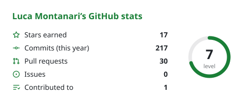
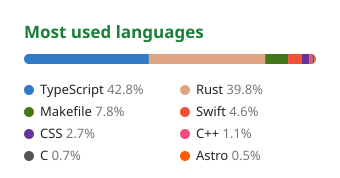
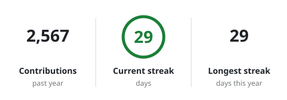
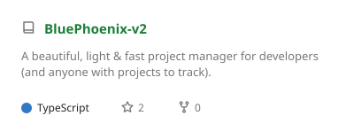
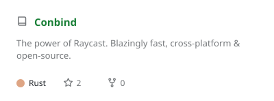

<!-- studio:settings user=montanari-luca theme=auto hl=2 border=hide light=github-light -->

<!-- studio:banner -->

  <picture>
    <source media="(prefers-color-scheme: dark)" srcset="https://raw.githubusercontent.com/montanari-luca/montanari-luca/main/profile-assets/banner-dark.svg?text=Luca%20Montanari&shape=waving&paint=timeGradient&animation=fadeIn&section=header&height=180&fontSize=52" />
    
  </picture>

<!-- studio:header -->
<h1 align="center">Hi, I'm Luca Montanari.</h1>

Software Engineer / Full-Stack dev

<!-- studio:paragraph -->

(actually, more like a project manager + prompt engineer + agent orchestrator + creative director + UX designer)

<!-- studio:split w=30.a -->
<table>
  <tr>
    <td width="30%" align="center" valign="top">
      
      
    </td>
    <td width="70%" align="center" valign="top">
      <picture>
        <source media="(prefers-color-scheme: dark)" srcset="https://raw.githubusercontent.com/montanari-luca/montanari-luca/main/profile-assets/card-stats-dark.svg?show_icons=true" />
        
      </picture>
    </td>
  </tr>
</table>

<!-- studio:langs+streak -->

  <picture>
    <source media="(prefers-color-scheme: dark)" srcset="https://raw.githubusercontent.com/montanari-luca/montanari-luca/main/profile-assets/card-langs-dark.svg?layout=compact&langs_count=8" />
    
  </picture>
  <picture>
    <source media="(prefers-color-scheme: dark)" srcset="https://raw.githubusercontent.com/montanari-luca/montanari-luca/main/profile-assets/card-streak-dark.svg" />
    
  </picture>

<!-- studio:stack -->
<h2 align="center">Tools I use</h2>

  <picture>
    <source media="(prefers-color-scheme: dark)" srcset="https://raw.githubusercontent.com/montanari-luca/montanari-luca/main/profile-assets/stack-dark.svg?i=tauri%2Crust%2Cts%2Creact%2Cpostgres%2Castro%2Cnextjs%2Cswift%2Cvscode%2Cjava&perline=10" />
    
  </picture>

<!-- studio:repos -->
<h2 align="center">Best OS Projects</h2>

  <a href="https://github.com/montanari-luca/BluePhoenix-v2"><picture>
    <source media="(prefers-color-scheme: dark)" srcset="https://raw.githubusercontent.com/montanari-luca/montanari-luca/main/profile-assets/card-repo-bluephoenix-v2-dark.svg?username=montanari-luca&repo=BluePhoenix-v2" />
    
  </picture></a>
  <a href="https://github.com/montanari-luca/Peppermint"><picture>
    <source media="(prefers-color-scheme: dark)" srcset="https://raw.githubusercontent.com/montanari-luca/montanari-luca/main/profile-assets/card-repo-peppermint-dark.svg?username=montanari-luca&repo=Peppermint" />
    
  </picture></a>
  <a href="https://github.com/montanari-luca/Conbind"><picture>
    <source media="(prefers-color-scheme: dark)" srcset="https://raw.githubusercontent.com/montanari-luca/montanari-luca/main/profile-assets/card-repo-conbind-dark.svg?username=montanari-luca&repo=Conbind" />
    
  </picture></a>
  <a href="https://github.com/montanari-luca/DolphinPod"><picture>
    <source media="(prefers-color-scheme: dark)" srcset="https://raw.githubusercontent.com/montanari-luca/montanari-luca/main/profile-assets/card-repo-dolphinpod-dark.svg?username=montanari-luca&repo=DolphinPod" />
    
  </picture></a>

<!-- studio:heading -->
## Currently working on

<!-- studio:paragraph -->
- Maintaining Peppermint
- Maintaining Conbind
- Building FireMoon Harness (Closed source)
- Building Murmur (Closed source)
- Improving BluePhoenix
